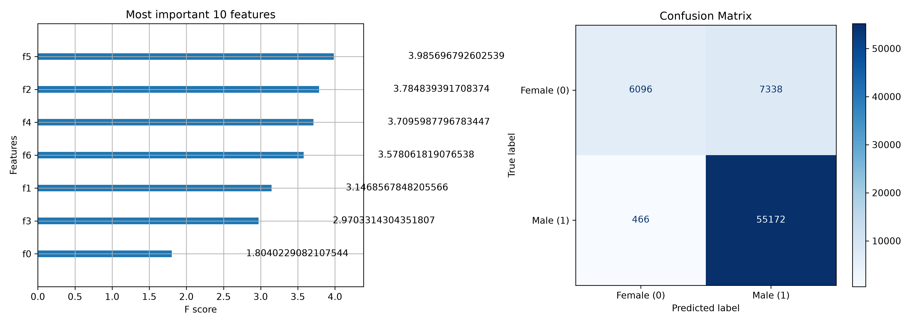

# divvy-xgboost-showcase
User gender prediction model using Divvy bike-sharing trip data and XGBoost.
# 🚲 User Gender Prediction with Divvy Bike-Sharing Data (XGBoost)

This repository showcases the methodology, architecture, and evaluation results of a machine learning classification pipeline built to predict user gender using Chicago's **Divvy** bike-sharing trip dataset (2019 Q1).

## 📊 Dataset and Preprocessing Pipeline

The following preprocessing and feature engineering steps were applied to the `Divvy_Trips_2019_Q1.csv` dataset:
* **Missing Value Handling:** Rows with missing target labels (`gender`) were dropped. Missing values in `birthyear` and `tripduration` were imputed using the median.
* **Data Type Conversion:** Comma-separated string values in `tripduration` were cleaned and converted into numeric (`float`) format.
* **Feature Engineering:** 
  * Categorical `usertype` was encoded using One-Hot Encoding.
  * High-cardinality station features (`from_station_name` and `to_station_name`) were encoded using **Target Encoding** strictly after the train-test split to prevent data leakage.

## ⚙️ Model Architecture and Hyperparameters

An **XGBoost Classifier** was configured with fine-tuned hyperparameters to maximize generalization and prevent overfitting:
* `n_estimators`: 337
* `learning_rate`: 0.00785
* `max_depth`: 12
* `colsample_bytree`: 0.6901
* `min_child_weight`: 1
* `gamma`: 0.2571

## 📈 Model Performance and Visualization

Evaluation accuracy scores across the training and test sets:
* **Train Accuracy:** `94.55%`
* **Test Accuracy:** `88.70%`

Feature importance rankings and the confusion matrix generated from the test set predictions:

## 🔒 Source Code Access

> **Note:** The source code is kept in a private repository for confidentiality. If you are a recruiter or collaborator and would like to review the code or discuss the methodology, please feel free to reach out to me via LinkedIn!

## 🛠️ Tech Stack
* **Python 3** | **Pandas & NumPy** | **Scikit-Learn & Category Encoders** | **XGBoost** | **Matplotlib**
